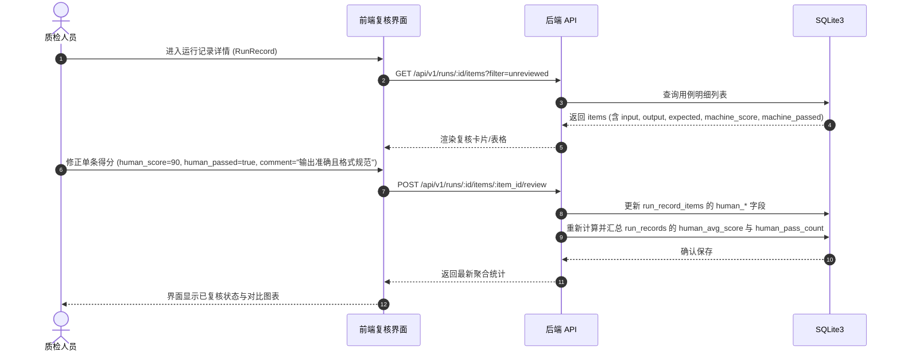

# Agent 评测系统技术设计方案

## 1. 架构概览与核心链路

本系统是基于 **Golang (Gin) + Goja (JS 引擎) + SQLite3 + React** 构建的轻量级、单二进制交付的端到端 Agent 黑盒评测平台。

```mermaid
flowchart TD
    subgraph Frontend["前端 (React + Vite SPA)"]
        UI["评测工作台 / 任务管理 / 场景调试 / 人工复核"]
    end

    subgraph Backend["后端服务 (Golang + Gin)"]
        API["Gin RESTful API (/api/v1/*)"]
        Scheduler["评测调度器 (Worker Pool 并发控制)"]
        
        subgraph GojaEngine["Goja 沙箱引擎"]
            ScriptExec["场景脚本执行: execute(env, input)"]
            Bridge["Go-JS 桥接: http, console.log"]
            EvalScript["自定义评测脚本: evaluate(input, output, expected)"]
        end
        
        subgraph EvaluatorPipeline["评测流水线 (Evaluators)"]
            RuleEval["规则评测器 (Exact/Contains/Regex)"]
            LLMEval["LLM-as-a-Judge (Prompt 裁判)"]
            ScriptEval["自定义脚本评测器"]
            Aggregator["加权得分与一票否决聚合器"]
        end
        
        DBClient["SQLite3 (WAL 模式连接池)"]
    end

    subgraph SUT["被测目标 (System Under Test)"]
        Agent["被测 Agent API / LLM 服务"]
    end

    subgraph JudgeLLM["评测裁判模型"]
        LLM["OpenAI-Compatible LLM (GPT-4o, Qwen, etc.)"]
    end

    UI -->|HTTP / 静态资源内嵌| API
    API --> Scheduler
    Scheduler --> GojaEngine
    GojaEngine -->|HTTP 请求| Agent
    Agent -->|实际输出 (Output)| GojaEngine
    GojaEngine --> EvaluatorPipeline
    EvaluatorPipeline -->|规则匹配| RuleEval
    EvaluatorPipeline -->|Prompt 判定| LLM
    EvaluatorPipeline -->|JS 计算| EvalScript
    EvaluatorPipeline --> Aggregator
    Aggregator --> DBClient
    API --> DBClient
```

---

## 2. 数据库模型设计 (SQLite3)

开启 `PRAGMA journal_mode = WAL;` 与 `PRAGMA busy_timeout = 5000;`。

### 2.1 环境配置表 (`environments`)
```sql
CREATE TABLE IF NOT EXISTS environments (
    id INTEGER PRIMARY KEY AUTOINCREMENT,
    name TEXT NOT NULL UNIQUE,
    description TEXT,
    variables_json TEXT NOT NULL DEFAULT '{}', -- 自由 JSON 字符串，如 {"BASE_URL": "...", "API_KEY": "..."}
    created_at DATETIME DEFAULT CURRENT_TIMESTAMP,
    updated_at DATETIME DEFAULT CURRENT_TIMESTAMP
);
```

### 2.2 场景配置表 (`scenarios`)
```sql
CREATE TABLE IF NOT EXISTS scenarios (
    id INTEGER PRIMARY KEY AUTOINCREMENT,
    name TEXT NOT NULL UNIQUE,
    description TEXT,
    script TEXT NOT NULL,                     -- Goja JS 脚本，实现 execute(env, input)
    created_at DATETIME DEFAULT CURRENT_TIMESTAMP,
    updated_at DATETIME DEFAULT CURRENT_TIMESTAMP
);
```

### 2.3 用例集与用例表 (`datasets`, `test_cases`)
```sql
CREATE TABLE IF NOT EXISTS datasets (
    id INTEGER PRIMARY KEY AUTOINCREMENT,
    name TEXT NOT NULL UNIQUE,
    description TEXT,
    case_count INTEGER NOT NULL DEFAULT 0,
    created_at DATETIME DEFAULT CURRENT_TIMESTAMP,
    updated_at DATETIME DEFAULT CURRENT_TIMESTAMP
);

CREATE TABLE IF NOT EXISTS test_cases (
    id INTEGER PRIMARY KEY AUTOINCREMENT,
    dataset_id INTEGER NOT NULL REFERENCES datasets(id) ON DELETE CASCADE,
    input_data TEXT NOT NULL,                 -- 输入内容（JSON 字符串或纯文本）
    expected_output TEXT,                     -- 期望输出 / Ground Truth
    metadata_json TEXT DEFAULT '{}',          -- 扩展元数据（标签、分类等）
    created_at DATETIME DEFAULT CURRENT_TIMESTAMP,
    updated_at DATETIME DEFAULT CURRENT_TIMESTAMP
);
CREATE INDEX IF NOT EXISTS idx_test_cases_dataset_id ON test_cases(dataset_id);
```

### 2.4 评测模块配置表 (`evaluators`)
```sql
CREATE TABLE IF NOT EXISTS evaluators (
    id INTEGER PRIMARY KEY AUTOINCREMENT,
    name TEXT NOT NULL UNIQUE,
    description TEXT,
    type TEXT NOT NULL,                       -- 'rule', 'llm_judge', 'script'
    config_json TEXT NOT NULL DEFAULT '{}',   -- 规则配置/Prompt模板/评测JS脚本
    created_at DATETIME DEFAULT CURRENT_TIMESTAMP,
    updated_at DATETIME DEFAULT CURRENT_TIMESTAMP
);
```

### 2.5 评测任务表 (`evaluation_tasks`)
```sql
CREATE TABLE IF NOT EXISTS evaluation_tasks (
    id INTEGER PRIMARY KEY AUTOINCREMENT,
    name TEXT NOT NULL,
    description TEXT,
    scenario_id INTEGER NOT NULL REFERENCES scenarios(id),
    environment_id INTEGER NOT NULL REFERENCES environments(id),
    dataset_id INTEGER NOT NULL REFERENCES datasets(id),
    evaluator_configs_json TEXT NOT NULL,     -- 数组: [{"evaluator_id": 1, "weight": 1.0}, ...]
    concurrency INTEGER NOT NULL DEFAULT 3,   -- 并发协程数
    max_retries INTEGER NOT NULL DEFAULT 0,   -- 单 Case 重试次数
    created_at DATETIME DEFAULT CURRENT_TIMESTAMP,
    updated_at DATETIME DEFAULT CURRENT_TIMESTAMP
);
```

### 2.6 运行记录与用例明细表 (`run_records`, `run_record_items`)
```sql
CREATE TABLE IF NOT EXISTS run_records (
    id INTEGER PRIMARY KEY AUTOINCREMENT,
    task_id INTEGER NOT NULL REFERENCES evaluation_tasks(id),
    status TEXT NOT NULL DEFAULT 'PENDING',   -- 'PENDING', 'RUNNING', 'COMPLETED', 'FAILED', 'CANCELED'
    total_count INTEGER NOT NULL DEFAULT 0,
    success_count INTEGER NOT NULL DEFAULT 0,
    error_count INTEGER NOT NULL DEFAULT 0,
    
    -- 机器评估聚合指标
    machine_pass_count INTEGER NOT NULL DEFAULT 0,
    machine_avg_score REAL NOT NULL DEFAULT 0.0,
    
    -- 人工复核后指标
    human_pass_count INTEGER NOT NULL DEFAULT 0,
    human_avg_score REAL NOT NULL DEFAULT 0.0,
    reviewed_count INTEGER NOT NULL DEFAULT 0,
    
    started_at DATETIME,
    finished_at DATETIME,
    created_at DATETIME DEFAULT CURRENT_TIMESTAMP
);

CREATE TABLE IF NOT EXISTS run_record_items (
    id INTEGER PRIMARY KEY AUTOINCREMENT,
    run_record_id INTEGER NOT NULL REFERENCES run_records(id) ON DELETE CASCADE,
    test_case_id INTEGER NOT NULL REFERENCES test_cases(id),
    input_data TEXT NOT NULL,
    expected_output TEXT,
    actual_output TEXT,
    status TEXT NOT NULL,                     -- 'COMPLETED', 'ERROR'
    error_message TEXT,
    latency_ms INTEGER NOT NULL DEFAULT 0,
    execution_log TEXT,                       -- JS console.log 记录
    
    -- 机器评估双轨
    machine_score REAL NOT NULL DEFAULT 0.0,
    machine_passed BOOLEAN NOT NULL DEFAULT 0,
    machine_details_json TEXT DEFAULT '[]',   -- 各 Evaluator 的得分与理由明细
    
    -- 人工复核双轨
    human_score REAL,
    human_passed BOOLEAN,
    human_comment TEXT,
    reviewer_name TEXT,
    reviewed_at DATETIME,
    
    created_at DATETIME DEFAULT CURRENT_TIMESTAMP
);
CREATE INDEX IF NOT EXISTS idx_run_items_record_id ON run_record_items(run_record_id);
```

### 2.7 系统配置表 (`system_configs`)
```sql
CREATE TABLE IF NOT EXISTS system_configs (
    key TEXT PRIMARY KEY,
    value TEXT NOT NULL,
    description TEXT,
    updated_at DATETIME DEFAULT CURRENT_TIMESTAMP
);
```

---

## 3. Goja 沙箱与场景脚本契约

### 3.1 场景脚本契约
开发者在「场景配置」中只需编写标准的 JavaScript 函数 `execute(env, input)`：

```javascript
/**
 * 执行单条用例调用
 * @param {Object} env 环境配置 JSON 反序列化得到的对象，如 env.BASE_URL, env.API_KEY
 * @param {any} input 用例输入数据（若是 JSON 字符串已自动解析为 Object）
 * @returns {string|Object} 被测 Agent 的实际输出结果
 */
function execute(env, input) {
    const url = env.BASE_URL + "/v1/chat/completions";
    const payload = {
        model: env.MODEL || "default-agent",
        messages: [{ role: "user", content: typeof input === 'string' ? input : input.prompt }]
    };
    
    console.log("正在请求 Agent:", url);
    const resp = http.post(url, {
        headers: {
            "Content-Type": "application/json",
            "Authorization": "Bearer " + env.API_KEY
        },
        body: JSON.stringify(payload),
        timeout_seconds: 30
    });
    
    if (resp.status_code !== 200) {
        throw new Error("Agent 响应异常: HTTP " + resp.status_code + " - " + resp.body);
    }
    
    const data = JSON.parse(resp.body);
    return data.choices[0].message.content;
}
```

### 3.2 Goja 注入的宿主对象与异步轮询机制
1. **`http` 对象**：
   - `http.get(url, options)`
   - `http.post(url, options)`
   - `http.request(options)`，参数包含 `method`, `url`, `headers`, `body`, `timeout_seconds`；返回 `{ status_code: number, headers: object, body: string, json: () => any }`。
2. **`sleep(ms)` 异步挂起函数**：
   - 支持毫秒级定时挂起（如 `sleep(1500)`），底层由 Go `time.After` 协程调度，**非忙等、不消耗 CPU 资源**，且自动响应系统 `context` 的超时与中断取消。
   - 完美适配**异步长耗时 Agent 场景**：先提交生成任务，后在 `while` 循环中结合 `sleep(ms)` 轮询状态接口，直到任务成功获取最终回答。
3. **`console.log(...)`**：重定向输出到单 Case 的 `execution_log`。
4. **安全与超时机制**：
   - 系统全局配置 `default_timeout_seconds` 动态控制单 Case 执行上限（超期自动中断并标记为 `ERROR`）。
   - 禁止任何非法本地文件系统与系统调用。

### 3.3 异步长任务轮询典型脚本范式
```javascript
function execute(env, input) {
    // 1. 发起异步任务提交
    const submitResp = http.post(env.BASE_URL + "/api/async/create", {
        headers: { "Authorization": "Bearer " + env.API_KEY, "Content-Type": "application/json" },
        body: JSON.stringify({ prompt: input.prompt || input })
    });
    const taskId = submitResp.json().task_id;
    console.log("异步任务提交成功, TaskID:", taskId);

    // 2. 轮询状态接口
    const maxWaitSeconds = 90;
    const pollIntervalMs = 2000;
    const startTime = Date.now();

    while ((Date.now() - startTime) < maxWaitSeconds * 1000) {
        sleep(pollIntervalMs); // 挂起 2 秒，避免忙等
        const queryResp = http.get(env.BASE_URL + "/api/async/status?task_id=" + taskId, {
            headers: { "Authorization": "Bearer " + env.API_KEY }
        });
        if (queryResp.status_code === 200) {
            const data = queryResp.json();
            if (data.status === "SUCCESS") return data.output; // 成功提取真实输出
            if (data.status === "FAILED") throw new Error("异步任务处理失败: " + data.error);
        }
    }
    throw new Error("异步轮询超时");
}
```

---

## 4. 评测模块与聚合规则

### 4.1 评测模块分类
1. **Rule Evaluator (规则校验)**：
   - `exact_match`：`output.trim() === expected.trim()`
   - `contains`：`output.includes(expected)`
   - `regex`：正则匹配 `new RegExp(config.pattern).test(output)`
2. **LLM-as-a-Judge (大模型裁判)**：
   - 提取系统配置或 Evaluator 自定义配置的裁判模型。
   - 组装裁判 Prompt，要求返回标准 JSON `{ "score": 85, "passed": true, "reason": "回答切中要点..." }`。
3. **Script Evaluator (自定义 JS 评测)**：
   - 编写 `function evaluate(input, output, expected)`，返回 `{ score: 100, passed: true, reason: "..." }`。

### 4.2 聚合算法
对于拥有 $N$ 个 Evaluator 的任务：
- **加权平均得分**：
  $$\text{machine\_score} = \frac{\sum_{i=1}^N \text{score}_i \times \text{weight}_i}{\sum_{i=1}^N \text{weight}_i}$$
- **一票否决通过判定**：
  $$\text{machine\_passed} = \bigwedge_{i=1}^N \text{passed}_i \quad (\text{必须所有 Evaluator 均为 true})$$

### 4.3 飞书 SSO 单点登录与会话管理
1. **认证协议**：对接飞书开放平台 OAuth 2.0 Web 网页应用授权流程。
   - `GET /api/v1/auth/feishu/url`：动态生成飞书网页授权跳转地址。
   - `GET /api/v1/auth/feishu/callback`：拦截飞书回跳携带的 `code`，换取 `app_access_token` 与用户资料（open_id, union_id, name, avatar_url, email）。
2. **会话令牌**：基于 HMAC-SHA256 签发轻量级 JWT Session Token，客户端存入 `localStorage` 并在请求时通过 `Authorization: Bearer <token>` 携带。
3. **质检双轨身份绑定**：人工复核时，系统自动读取当前登录用户的身份，将 `reviewer_name` 默认填充为登录账号姓名，实现评测质检责任可追溯。
4. **免密与调试通道**：提供本地快速体验通道（Dev Login），在未配置飞书开放平台参数或离线环境下保障平台可用性。

---

## 5. 人工复核交互工作流



---

## 6. 工程结构与单二进制发布

```
agent-evaluation/
├── cmd/
│   └── server/
│       └── main.go                  # 程序入口，支持静态资源嵌入
├── internal/
│   ├── api/                         # Gin 路由处理层
│   │   ├── auth.go                  # 飞书 SSO 与 JWT 会话鉴权
│   │   ├── environment.go
│   │   ├── scenario.go
│   │   ├── dataset.go
│   │   ├── evaluator.go
│   │   ├── task.go
│   │   ├── run.go
│   │   └── system_config.go
│   ├── engine/                      # Goja 执行沙箱与 Worker Pool 调度
│   │   ├── runner.go                # 任务执行调度器 (Worker Pool)
│   │   ├── sandbox.go               # Goja 虚拟机初始化与超时熔断
│   │   └── bridge_http.go           # 注入 JS 的 HTTP 客户端
│   ├── evaluator/                   # 评测器实现
│   │   ├── evaluator.go             # 统一接口
│   │   ├── rule.go                  # 规则评测
│   │   ├── llm_judge.go             # 大模型裁判
│   │   └── script.go                # Goja 自定义脚本评测
│   ├── model/                       # 数据库实体与 GORM/Sqlx 映射
│   │   └── models.go
│   └── service/                     # 业务逻辑与聚合计算
│       └── ...
├── web/                             # React 前端工程 (pnpm)
│   ├── src/
│   │   ├── pages/                   # 页面 (环境/场景/用例/任务/运行/复核/系统配置)
│   │   ├── components/              # 脚本编辑器、结果对比卡片、JSON 查看器
│   │   ├── api/                     # Axios 请求封装
│   │   └── App.tsx
│   ├── package.json
│   └── vite.config.ts
├── docs/
│   ├── DESIGN.md                    # 本设计方案
│   └── adr/                         # 架构决策记录 (0001, 0002)
├── GLOSSARY.md                      # 领域统一术语表
├── AGENTS.md                        # 项目指南
├── go.mod
└── go.sum
```
